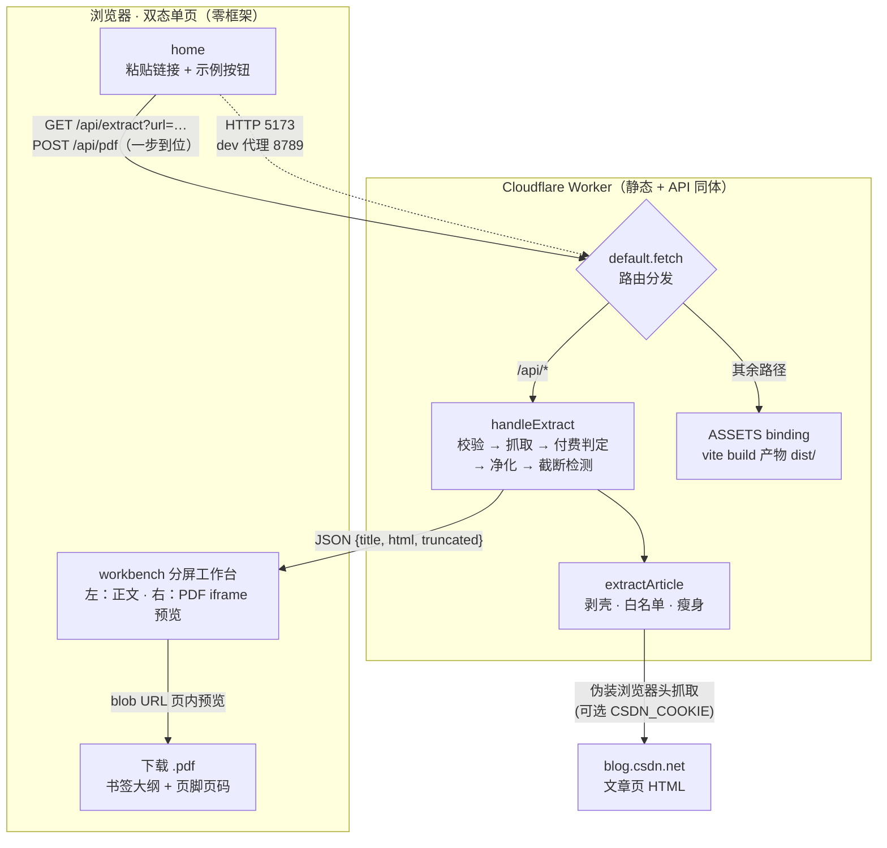

<div align="center">

# 📄 CSDN → PDF

**把一篇 CSDN 文章"读干净"——粘贴链接，得到只含标题与正文的清净阅读页，一键存成 US Letter 排版的 PDF。**

*Read CSDN articles clean, then keep them as PDF.* / Vite + TypeScript · Cloudflare Workers · 零存储

[](https://www.typescriptlang.org/)
[](https://developers.cloudflare.com/workers/)
[](https://vite.dev/)
[](./src/main.ts)
[](#-核心亮点)

[快速开始](#-快速开始) · [架构总览](#-架构总览) · [核心亮点](#-核心亮点) · [项目结构](#-项目结构)

</div>

---

## 🤔 这是什么

CSDN 的文章页塞满了评论区、侧栏、广告、AI 摘要和"关注博主"遮罩——直接 Ctrl+P 打印，纸上是垃圾场。

**csdn-to-pdf** 是一台"正文榨汁机"：

1. 粘贴一篇 `blog.csdn.net` 文章链接；
2. 服务端（Cloudflare Worker）抓取页面，**白名单净化**：剥掉一切脚手架，只留标题与正文；
3. 页面展开为**分屏工作台**：左侧清净正文、右侧 PDF 原生预览一步到位（代码高亮、图片原样保留，CSDN 藏在正文里的内嵌目录不出现）；
4. 右侧确认 PDF 成品（Letter 纸、侧边栏书签大纲、页脚页码）后点**下载**——全程无打印对话框、不跳页、不清屏。

> **约定边界**：VIP / 付费专栏文章直接拒绝，本工具不做（403）。免费正文读完即走，服务端**零存储**——不落库、不缓存、不留痕。

<details>
<summary><b>💡 为什么不直接浏览器里抓 CSDN？</b>（点击展开）</summary>

CSDN 不提供跨域 CORS 头，浏览器直连会被同源策略拦截；图片防盗链（csdnimg.cn）也按 referer 拒绝外站。所以抓取必须放在服务端：没有 CORS 限制，还能伪装完整的浏览器请求头，并给图片统一加 `no-referrer` 破防盗链。
</details>

## ✨ 功能全景

- 🧹 **剥掉脚手架** — 评论区/侧栏/广告/复制按钮/AI 摘要，一个不留（`JUNK_SELECTORS`，worker/src/index.ts:76）
- 🛡️ **白名单净化** — 标签与属性双白名单 + 链接 scheme 校验，杜绝脚本注入，`innerHTML` 注入有三道闸（index.ts:76-186）
- 🖼️ **图片防盗链破解** — 正文图片统一 `referrerpolicy="no-referrer"`（index.ts:177）
- 📝 **代码高亮保留** — CSDN 服务端自带的 Prism `token/*` 标记原样存活，自绘 GitHub 风浅色 token 配色（阅读页与 PDF 同色），零高亮库依赖（index.ts:149，style.css:354）
- 📑 **内嵌目录剥除** — CSDN 编辑器藏进正文的 `.toc`/`#main-toc`/`#hr-toc` 目录块（原站靠自带 CSS 隐藏）在净化源头删除，PDF 不再冒出"原文章没有的目录"；标题 `id` 保留，PDF 书签大纲可导航（index.ts:76-98）
- 🖨️ **无对话框 PDF 引擎 + 页内预览** — 双引擎路由：本地无头 Chromium（puppeteer-core 驱动本机 Edge/Chrome）→ 云端 Browser Rendering，产出带 **PDF 书签大纲（h1-h3）** + **页脚页码** 的成品文件，在右侧面板用浏览器原生查看器**页内预览**，确认后再下载（server/local-pdf.ts / src/print-doc.ts）
- 🔁 **重转不清场** — 工作台命令栏常驻吸顶，转换期间左右旧内容原地保留、右侧盖「转换中」进度层，新内容到达才替换
- 🔗 **链接 scheme 白名单** — `a[href]` 只放行 http(s)/mailto/页内锚点，`javascript:` 等危险 scheme 在净化阶段没收，相对路径自动补全为绝对 URL（worker/src/index.ts:57）
- 🖼️ **图片等待兜底** — PDF 渲染前等待网络空闲 + 逐张确认图片加载，CSDN 图床慢图不缺页（server/local-pdf.ts:111-117）
- 🌗 **自动深浅双模式** — `prefers-color-scheme` 整套换色，含打印专属浅色皮（style.css:31-48）
- ⚠️ **截断诚实提示** — "关注可见"文章只抓到开头时亮黄条告知，并给出补救路径（index.ts:260-266）
- 🚫 **付费边界拒绝** — 组合判据识别 VIP/付费专栏，明确拒绝不误杀（index.ts:242-250）
- 🕳️ **零存储** — 抓完即走，Worker 无数据库、无缓存、无日志留存

## 🏗️ 架构总览



| 层 | 技术 | 落点 |
|---|---|---|
| 前端 | Vite 8 + TypeScript 7，零框架单页 | `index.html` / `src/main.ts` / `src/style.css` |
| 后端 | Cloudflare Worker（fetch 处理器） | `worker/src/index.ts` |
| 解析 | node-html-parser（唯一业务依赖） | `worker/src/index.ts:13` |
| 部署 | wrangler 4，静态资产与 API 同一 Worker | `wrangler.toml` |

## 💡 核心亮点

1. **白名单净化管线（deny-by-default）** — 不是拉黑名单拦截，而是"没申报的一律没收"：`KEEP_TAGS` 32 个标签之外连内容删除，每个标签属性按 `allowedAttrs` 收窄，`a[href]` 再过 scheme 白名单，script/iframe/表单在 `JUNK_SELECTORS` 阶段整块剥除。这是 `innerHTML` 注入前的安全前提（worker/src/index.ts）。
2. **三级兜底对抗改版** — 标题取值 `h1.title-article → og:title → <title>`、正文容器 `#content_views → .article_content → .markdown_views`，CSDN 小改版不致全挂（index.ts:136-146）。
3. **打印皮与工具皮分离** — 打印版式与工具界面由两套 CSS 各管各的：阅读页换皮走 `@media print`，导出成品走 `print-doc.ts` 的 PRINT_CSS（与引擎 `@page` 参数严格一致），渲染全程无打印对话框（src/print-doc.ts / src/style.css）。
4. **组合判据付费检测** — 遮罩文案付费字样 ∨（购买按钮 ∧ data-price），且需 `articleType=1` 前置条件——多信号防止误杀免费文章（index.ts:242-250）。
5. **一个部署全搞定** — `wrangler.toml` 把 `dist/` 挂成 `ASSETS` 绑定，Worker 一个 `fetch` 同时服务静态页与 `/api`，`npm run deploy` 一次上线（index.ts:276-313）。
6. **no-referrer 破防盗链** — 给所有正文图片强制 `referrerpolicy="no-referrer"`，csdnimg.cn 对"无来源"请求放行（index.ts:177）。

## 🗂️ 项目结构

```
csdn-to-pdf/
├── 🌐 index.html          # 双态骨架：顶栏双态 + home / workbench（左正文 · 右 PDF）
├── 📁 src/                # ─── 前端（Vite 构建）───
│   ├── ⚛️ main.ts         # 双态状态机（home / workbench）+ 一步到位转换 + blob 页内预览 + 双引擎
│   ├── 🎨 style.css       # 设计 token / 三状态样式 / 打印排版
│   └── 🏷️ vite-env.d.ts   # Vite 类型声明
├── 📁 worker/             # ─── 后端（Cloudflare Worker）───
│   ├── ⭐ src/index.ts    # 全部业务逻辑：抓取 + 净化管线 + scheme 白名单 + 路由
│   └── 🏷️ tsconfig.json   # workers-types 配置
├── ⚙️ vite.config.ts      # dev 时 /api 代理到 wrangler (8789)
├── ⚙️ wrangler.toml       # ASSETS 绑定 dist/，静态与 API 同 Worker
└── 📦 package.json        # dev:fe / dev:api / build / preview / deploy / typecheck
```


## 🚀 快速开始

**0️⃣ 环境要求**

| 组件 | 版本 | 说明 |
|---|---|---|
| Node.js | ≥ 18 | npm 随附 |
| Cloudflare 账号 | 可选 | 仅部署需要 |

**1️⃣ 安装依赖**

```bash
npm install
```

**2️⃣ 启动本地开发（两个终端）**

```bash
npm run dev:api    # 终端 1：wrangler dev → API @ http://127.0.0.1:8789
npm run dev:fe     # 终端 2：Vite dev → 页面 @ http://localhost:5173（/api 已代理）
```

**3️⃣ 体验核心链路**

1. 打开 [http://localhost:5173](http://localhost:5173)
2. 点"试一试"任一示例文章（一键填入并转换，页面展开为分屏工作台）
3. 右侧 PDF 预览生成完毕（本地引擎，需先跑 `npm run pdf-server`；未启动会自动回退云端或给出明确指引），页内确认后点**下载**

**4️⃣ 类型检查 / 构建 / 部署**

```bash
npm run typecheck    # 前端 + 后端双 tsconfig 校验
npm run pdf-server   # 本地 PDF 引擎（无头 Chromium，端口 8788）
npm run preview      # 本地全真预览：一个端口同时服务页面与 API
npm run deploy       # 构建 + 部署到 Cloudflare Workers
```

## ⚙️ 配置说明

| 配置 | 位置 | 必填 | 默认 | 说明 |
|---|---|---|---|---|
| Worker 名 / 兼容日期 | `wrangler.toml` | 否 | `csdn-to-pdf` / `2025-01-01` | 部署标识与运行时行为快照 |
| 静态资产绑定 | `wrangler.toml [assets]` | 否 | `directory=./dist`，`binding=ASSETS` | 与 vite `outDir` 对齐 |
| dev 代理 | `vite.config.ts` | 否 | `/api → 127.0.0.1:8789` | 仅 `dev:fe` 生效 |
| 本地 PDF 引擎端口 | `server/local-pdf.ts` / `$env:PDF_SERVER_PORT` | 否 | `8788` | 8787 留给 ipynb-to-pdf 的 pdf-server |
| `CSDN_COOKIE` | `wrangler secret put` / 本地 `.dev.vars` | 否 | 无 | 登录态 Cookie，"关注可见"截断文章拿全文用。已随 fetch 发送（index.ts:208） |

💡 **最低可用配置**：以上全部留默认即可运行——`npm install` 后两条 dev 命令就能转换文章。

## 🗺️ Roadmap

- [x] 服务端抓取 + URL 白名单校验
- [x] 白名单净化（标签 + 属性 + 空壳清理）
- [x] 图片 no-referrer 破防盗链
- [x] 代码高亮 class 保留与自绘配色（Prism token 体系，阅读页与 PDF 同一套 GitHub 风浅色）
- [x] ~~A4 打印排版~~ → 无对话框 PDF 引擎（书签大纲 + 页脚页码，学自 ipynb-to-pdf）
- [x] VIP/付费文章边界拒绝 + 截断诚实提示
- [x] 深浅双模式 + 窄屏适配
- [x] 修复 `CSDN_COOKIE` 未随 fetch 发送的缺陷（fetch 现引用 headers 变量）
- [x] `a[href]` scheme 校验（拦截 `javascript:` 链接，相对路径补全为绝对 URL）
- [x] 修复本地引擎探测失败被永久缓存、导致"重试"永远走不到本地引擎的缺陷
- [x] 纸张口径统一为 US Letter，对齐参考版 ipynb-to-pdf（PRINT_CSS @page / 云端 / 本地引擎三处一致，本地引擎靠 preferCSSPageSize + @page 决定纸张）
- [x] 本地引擎转换失败自动回退云端 + 60s TTL 探测 + 本地服务防护三件套（Origin/Host/Content-Type，学自 ipynb-to-pdf）
- [ ] 导出 Markdown
- [ ] 适配第二个站点（如掘金 / 博客园）

<div align="center">

**只留正文，其他全清。**

觉得有用请点一个 ⭐ · Fork → Branch → PR 欢迎参与

</div>
